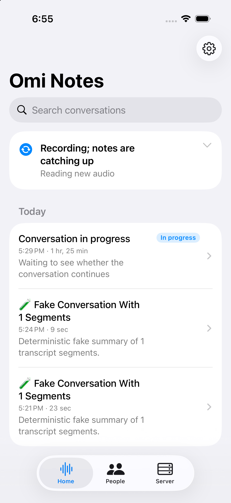
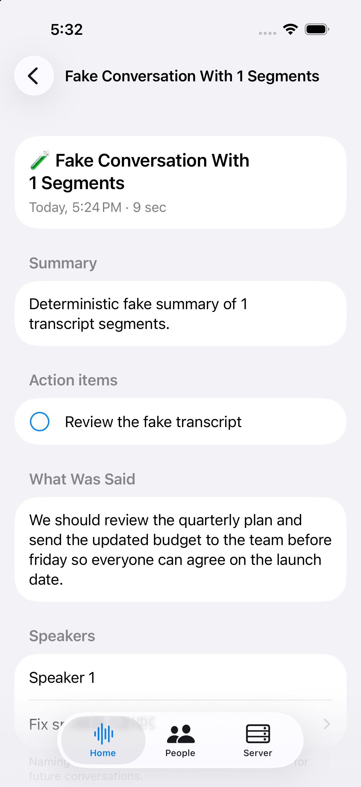
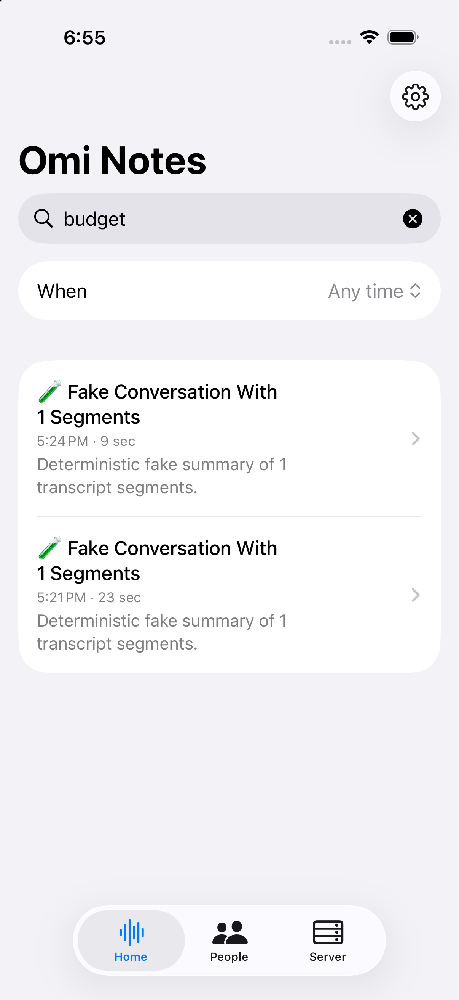
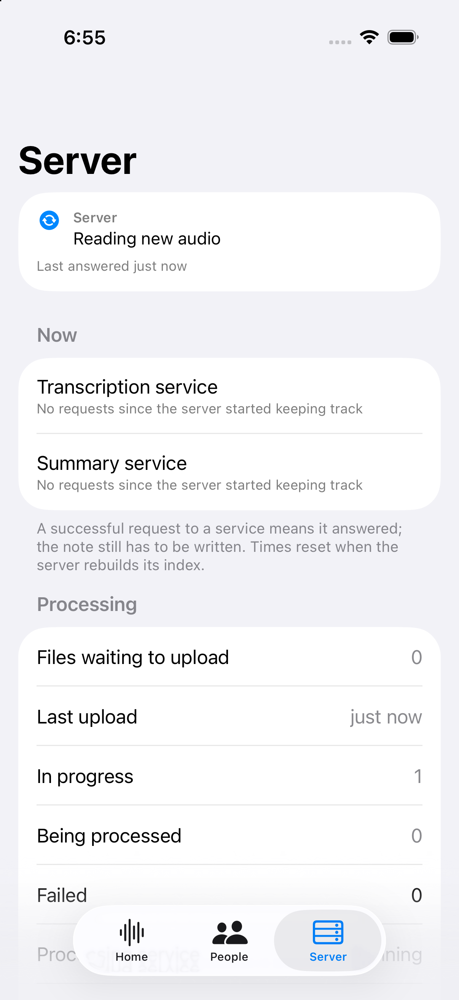
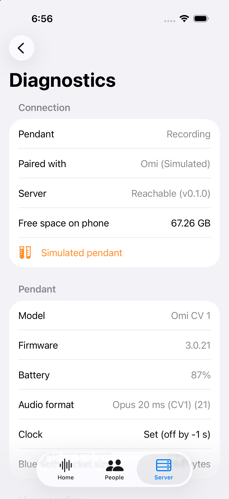
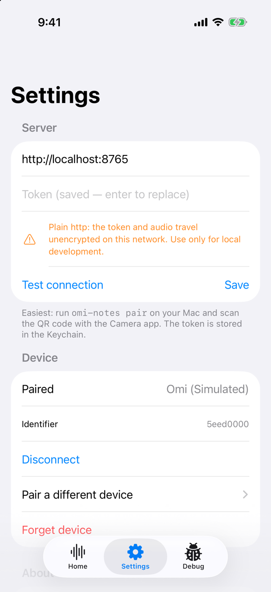
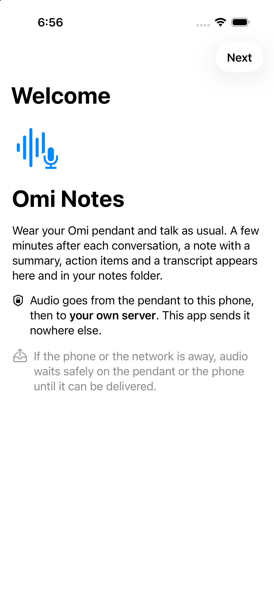

# Omi Notes — iPhone and Apple Watch apps

The phone is an **audio courier** for two independent sources:

- an **Omi pendant** over Bluetooth LE: the phone journals every audio notification to disk first,
  pulls the pendant's offline backlog (ring storage), and uploads immutable chunk files;
- the **Apple Watch app** (watchOS 10+): you start a recording on the Watch, it records in
  one-minute AAC parts, and the phone receives them over WatchConnectivity and uploads them.

Use either one, or both at once. Everything goes to your own omi-notes server, which does the
decoding, transcription and note writing. The phone never decodes the pendant's Opus or
reassembles its frames; it decodes Watch audio only to send PCM to a server without Watch AAC
support.

Contract: [`docs/capture-format-v1.md`](../docs/capture-format-v1.md). Device facts:
[`docs/device-protocol.md`](../docs/device-protocol.md). Design decisions:
[`docs/architecture.md`](../docs/architecture.md).

## Screenshots

Simulator with the simulated pendant, uploading to a local backend (fake STT/LLM providers):

| Home | Conversation | Search | Server |
|---|---|---|---|
|  |  |  |  |

| Diagnostics | Settings | Welcome |
|---|---|---|
|  |  |  |

## Using the app

- **Home** answers "is it working?" in one sentence (tap it for pendant/Watch → phone → server → notes,
  each with a fix), lists what needs you, and shows conversations by day. Tap one for its summary,
  action items, speakers, transcript and My Notes; fix speaker names from there, open the note in
  Obsidian (set the vault name in Settings), or retry it if it failed. Search covers titles,
  summaries, speaker names and transcripts, with time and person filters.
- **Devices**: a card for each device in use (pendant, Apple Watch) with its own page, plus
  **Transfers**, which shows each stage separately: Watch → iPhone, iPhone → server (with the
  current upload rate while the app is open) and what the server is still processing.
- **People**: teach the server your voice, name people and recurring voices.
- **Server**: what the server is doing now, what needs attention with plain reasons and next
  steps (and Retry where the phone can do it), the past seven days, its configuration (view only;
  it is changed on the server) and the connection. **Diagnostics** has the pendant, Bluetooth and
  upload details that used to be on Home.
- **Settings** (gear on Home): the devices, opt-in alerts for problems the phone sees (recording
  stopped on the pendant or the Watch, audio that couldn't upload, uploads paused), the Obsidian
  vault name, and notes saved for reading offline.

Health states: *normal*, *working* (uploading, processing), *unknown* (not checked yet, or the last
answer is over 5 minutes old; a disconnected pendant is unknown because it may be recording to its
own storage), *delayed* (held up but safe, e.g. the server is unreachable and audio waits on the
phone), *needs action*. "Ready" in the server configuration means configured, not proven to work.

Notes you open are kept on the phone (up to 50, in Caches, protected while locked) so they can be
read without a connection; they are removed when you pair with another server, and from Settings.

## Layout

```
ios/
  project.yml                  XcodeGen spec (OmiNotes.xcodeproj is generated and gitignored)
  Config/Base.xcconfig         shared settings; includes the optional Local.xcconfig
  Config/Local.xcconfig.example
  OmiNotes/                    thin SwiftUI iPhone app: App/ (entry, AppDelegate, Watch bridge), Features/, Resources/
  OmiNotesWatch/               Apple Watch app: recorder, relay to the iPhone, its one screen
  OmiNotesComplication/        circular watch-face complication (WidgetKit)
  OmiNotesLiveActivity/        sync Live Activity (not released yet; see below)
  Shared/                      views shared by the iPhone app and the Live Activity
  Packages/OmiKit/             most logic, testable with `swift test` on the Mac
    Sources/OmiProtocol/       GATT ids, ring protocol, button/codec/firmware parsing, CRC32, OMINOTE1 envelope
    Sources/OmiCapture/        journal, chunk rotation, outbox, uploader, ring sync, recovery, retention, storage guard
    Sources/OmiBLE/            CoreBluetooth central, per-connection sequence, simulated device, engine, app model, Watch relay
    Sources/OmiWatchKit/       shared by the Watch and iPhone apps: segment writer, relay messages, complication state
  Tools/make_sim_trace.py      regenerates the simulated-device trace and the test Opus packets
  Tools/make_app_icon.swift    draws the app icon
```

## Build and test

Requires Xcode 27 or later (iOS 27 SDK), and XcodeGen (`brew install xcodegen`). The deployment
targets are iOS 17 and watchOS 10; the `OmiNotes` scheme builds the iPhone app with the Watch app,
the complication and the Live Activity embedded. There are no third-party dependencies.

```sh
cd ios/Packages/OmiKit && swift test          # all unit + integration tests (macOS host)
cd ios && xcodegen generate                   # creates OmiNotes.xcodeproj
xcodebuild -project OmiNotes.xcodeproj -scheme OmiNotes \
  -destination 'generic/platform=iOS Simulator' CODE_SIGNING_ALLOWED=NO build
```

`swift test` also rewrites the deterministic contract fixtures in
[`contracts/fixtures/swift/`](../contracts/fixtures/swift/README.md). The backend's test suite
parses them.

## Install on your iPhone

1. **Signing.** Copy `Config/Local.xcconfig.example` to `Config/Local.xcconfig` (it is
   gitignored). Set:
   - `DEVELOPMENT_TEAM`: your team id; add your account in Xcode › Settings › Accounts. Which
     signing capabilities and provisioning are available depends on the team; a free Apple ID
     "Personal Team" hasn't been verified with the Watch app and extensions. The id appears in
     the team list, or at developer.apple.com › Membership for paid accounts.
   - `OMI_APP_BUNDLE_ID`: something unique to you, e.g. `com.yourname.omi-notes`. The Watch app
     (`….watchkitapp`), the complication (`….watchkitapp.widgets`) and the Live Activity
     (`….liveactivity`) derive their bundle IDs from it, so set this rather than
     `PRODUCT_BUNDLE_IDENTIFIER`.
2. `cd ios && xcodegen generate && open OmiNotes.xcodeproj`
3. Connect the iPhone with a cable (or pair it for Wi‑Fi debugging). Choose it as the run
   destination and press Run.
4. First time only, on the phone:
   - Settings › Privacy & Security › **Developer Mode** → on, then restart.
   - With a free Personal Team, if iOS says the developer is untrusted: Settings › General ›
     **VPN & Device Management** › your Apple ID › Trust.
5. With a free Personal Team the provisioning profile expires after 7 days. Run from Xcode again
   to renew it. Your recordings are kept; the app just won't launch until you re-sign it.

### Apple Watch

The Watch app is embedded in the iPhone app, so installing the iPhone app is all the building it
needs. On the iPhone, open the **Watch** app, find Omi Notes under *Available Apps* and tap
**Install** (it may already be installed). A development build may also need Developer Mode turned
on in the Watch's own Settings. The Watch app works with this iPhone install only: it learns which
iPhone it belongs to the first time they connect, and nothing else needs pairing.

## TestFlight

> **The existing Mac Studio setup uses manual local signing and a Developer-role API key.** Follow
> "TestFlight on this Mac" in [`AGENTS.md`](../AGENTS.md) for it; the workflow below needs an Admin
> key and is only for a fresh cloud-signing setup.

`make testflight` (or `ios/Tools/testflight.sh`) archives a Release build and uploads it to App Store
Connect. Signing is automatic and cloud-managed through an App Store Connect API key, so no
certificates or profiles need to be set up by hand. One-time setup, in App Store Connect:

1. **API key:** Users and Access › Integrations › App Store Connect API › Team Keys › generate a key
   with the **Admin** role (cloud-managed distribution signing requires it; an App Manager key fails
   at export). Save `AuthKey_<KEY_ID>.p8` to `~/.appstoreconnect/private_keys/` and note the Key ID
   and Issuer ID.
2. **App record:** Apps › + › New App (iOS, any available name, bundle ID from
   `OMI_APP_BUNDLE_ID`, default `dev.omi-notes.app`; register it under Identifiers first if
   it isn't offered). Any SKU.

> **Limitation:** `testflight.sh` predates the Watch app. It passes the app's bundle ID to every
> target, which the embedded Watch app, complication and Live Activity can't use, and each of
> those also needs its own App ID and profile for App Store distribution. Expect to adapt it.

Then `ASC_KEY_ID=… ASC_ISSUER_ID=… make testflight`. The build number is a UTC timestamp to the second, so every
upload is newer. After processing, add yourself under TestFlight › Internal Testing. Internal
testing needs no Beta App Review; external testers do. The app ships with an original icon
(`Tools/make_app_icon.swift`), a privacy manifest, and `ITSAppUsesNonExemptEncryption = NO`
(HTTPS only).

## Pairing

1. **Server.** Set up Tailscale on the Mac and the iPhone so both are on the same tailnet. On the
   Mac, start the server and run `omi-notes pair`. Scan the QR code with the iPhone **Camera**
   app. The `omi-notes://configure?url=…&token=…` link opens the app, which shows a
   confirmation sheet with the destination host and a masked token. Tap **Save**. The token goes
   into the Keychain (readable after first unlock, so background uploads work). You can also
   enter the URL and token by hand in Settings, and **Test connection** calls `GET /v1/status`.
   - Use the `https://<mac>.<tailnet>.ts.net` URL that `tailscale serve` provides. Release builds
     accept only `https`. Debug builds (the default when you run from Xcode) also accept plain
     `http` for local-network hosts (`localhost`, `*.local`, private and Tailscale IPs) with a
     warning.
2. **Bluetooth.** Allow Bluetooth when asked. The app keeps a Bluetooth connection in the
   background (`bluetooth-central`).
3. **Device.** Onboarding, or Settings › Pair a device, lists nearby Omi pendants. Tap yours. The
   app remembers it and reconnects on its own from then on.
   - **Only one phone app can connect to the pendant at a time.** Disconnect or quit the official
     Omi app first, or the pendant won't show up.
   - Using only the Apple Watch? Skip the pendant; see [Apple Watch](#apple-watch-recording).

Pendant button: **single tap** = bookmark (shown in the note); **double tap** = end the current
conversation now. A 3 s long press powers the pendant off.

The pendant's page (Devices › pendant) shows the pendant with a battery ring (green, amber, coral
at 15% or less and not charging; grey dashed and "Battery unknown" when it isn't connected) and
one connection dot, then "Recording" only when audio actually arrived in the last minute, plus a
short card: an issue and its fix, files waiting on this iPhone, audio collected from the pendant's
own storage, and the tap gestures. Pendant details and Disconnect/Pair/Forget are under
**Manage pendant**; everything else is in **Troubleshooting**.

## Apple Watch recording

User-started background recording is supported. Continuous all-day use on a real Watch (endurance,
battery) and every interruption condition have not been validated.

- **Start and Stop on the Watch.** Open Omi Notes on the Watch and tap the red microphone. It keeps
  recording with your wrist down or the screen off (background audio, only while you have started
  a recording) until you tap Stop. It records nothing by itself: it does not start again after the
  Watch restarts, its battery runs out or the app is closed. Open it and tap the microphone again.
- **Interruptions.** A call or Siri interrupts the recording. It resumes when the system allows;
  otherwise the Watch shows Resume. With alerts on (Devices › Apple Watch, or Settings), the iPhone
  tells you when a recording stopped without your Stop, once the Watch can send it that news.
- **Parts and hand-over.** The Watch writes 16 kHz mono AAC (32 kbit/s) in one-minute parts cut
  inside the audio stream; rotation is designed to avoid a stop/start gap between parts (not proven
  as uninterrupted capture on a real Watch). It sends them over WatchConnectivity whenever the
  iPhone is reachable; when that happens is up to the system, so keep the iPhone nearby, ideally
  with Omi Notes open. A part is deleted from the Watch only after the iPhone has stored it and
  checked its hash. Away from the iPhone the Watch keeps waiting audio up to a configured backlog
  cap (600 MB, about 40 hours at 32 kbit/s; not a measured recording time) or until it is nearly
  full, then pauses until it can send; it never deletes waiting audio.
- **To the server.** The iPhone queues each part like pendant audio. A server that advertises
  `watch_aac` (it has ffmpeg) gets the Watch's AAC file unchanged; any other server gets 16 kHz PCM
  converted on the iPhone. A recording keeps whichever format it started with.
- **Where the audio is.** The Watch's one screen, Devices › Apple Watch and Devices › Transfers
  show it stage by stage: on the Watch, on this iPhone, uploaded. The length shown is the recorded
  length of the parts still waiting, not a part count. "All audio on iPhone" means the iPhone has
  it, not that the server or your notes do.
- **Complication.** Add the circular *Omi Notes* complication to a watch face. It shows whether the
  Watch is recording, paused or stopped by an error, and how much audio is waiting for the iPhone
  (e.g. `12m`). It is updated by the Watch app; the system decides when the face refreshes, and an
  old state turns into "unknown" rather than claiming to be live. Tapping it opens the app's status
  screen; it starts and stops nothing.
- **Both devices.** The pendant and the Watch can record at the same time. If they recorded the same
  conversation, the server compares them and may keep the Watch audio as an alternate recording of
  the pendant note instead of a second note.
- While recording (and once when the app comes to the front), the Watch also sends small samples of
  its battery level and its own work to your server (`watch_perf` events), shown under Devices ›
  Apple Watch. They describe the whole Watch, other apps included. This README makes no battery-life
  claim: recording all day uses the Watch's battery, so charge it overnight.
- Voice enrollment (People) uses the pendant; Watch audio is still transcribed and its speakers
  can be named like any other.

## People and voices

The **People** tab teaches your server who is speaking (see
[`docs/speaker-learning.md`](../docs/speaker-learning.md)):

- **Teach my voice:** enter your name (it becomes `People/<Name>.md`), wear the pendant, and read six
  short sentences. The phone only marks the time window (a `voice_enrollment_start` event, then
  `voice_enrollment_end`); the server pulls your voice from the normal pendant audio. Chunks from
  that window are held on the phone until the server has acknowledged the start, so the reading is
  never transcribed as a conversation.
- **Name people in a conversation:** Home › Recent conversations › a conversation lists its
  speakers with a playable clip and excerpt. Tap one to pick you, a person, a new person, or
  "unknown". Naming someone other than you needs a one-time acknowledgment and their knowledge.
- **Automatic names** show an "auto" badge with the evidence (distance, margin, seconds). They only
  switch on for a person after several confirmations on different days; until then the app
  suggests. "Re-summarize with names" rewrites the summary with the names (one LLM call).
- **Who is this?** (opt-in) lists voices that keep recurring. **Forget voice** deletes that person's
  voiceprints from the server.

Clips are rendered by the server as WAV and played from memory; the phone never decodes Opus.

## What happens while it runs

- Each BLE connection is one *live capture*. Audio notifications are appended to a CRC-protected
  journal (fsync at least once per second). About every 60 s, after 5 s without audio, on
  disconnect, on a double tap, or when the app goes to the background, the journal becomes an
  immutable `OMINOTE1` chunk in the outbox.
- On every connect to firmware ≥ 3.0.20, the app downloads the pendant's offline backlog. This is
  what the pendant recorded while the phone was away. The app then seals the sync so the server
  knows the gap is covered.
- Uploads go through a background `URLSession` (`PUT`, with a SHA-256 header), so they keep
  going while the app is suspended and resume after relaunch. Files the server rejects for good
  (409/413/422, or 400 five times) are **kept**, not deleted. Home and Server say so; Diagnostics lists them.
- Acknowledged files stay in `sent/` until the server has processed them plus 24 h (hard cap:
  7 days / 1 GB). Unacknowledged audio is never deleted.
- **Storage guard:** below 200 MB free, the app stops recording and deliberately disconnects so
  the pendant buffers to its own storage. It reconnects once 300 MB are free again.
- Data lives in `Application Support/OmiNotes/` (excluded from backups):
  `journal/{live,ring}/`, `outbox/{pending,sent,quarantine}/`, `watch/` (parts received from the
  Watch), `state/`.

## Background behavior and limits

- iOS wakes the app for Bluetooth events and relaunches it through state restoration if the
  system terminated it. While the pendant streams, the app stays scheduled. When the pendant's
  mic sleeps in silence (after ~10 s of quiet) the app is suspended; the next sound wakes it.
  None of this loses audio.
- **Force-quitting the app** (swiping it away in the app switcher) stops restoration and
  reconnection until you open it again. The pendant records to its own storage meanwhile, and
  that audio is synced on the next connection. Don't force-quit it.
- After a phone restart, open the app once. Nothing can run before the first unlock anyway, since
  files and the token are protected until then.
- Out of range or Bluetooth off: the app keeps a pending connection, which costs nothing. The
  pendant buffers to its storage (only if its clock is valid: the app sets it on every connect).
- Firmware limitation: the pendant frees offline audio once it has *sent* it, so a phone crash
  in the ~1 s between receiving and fsyncing can lose that second.
- Low Power Mode and poor reception can delay uploads. They are never dropped.

## Sync status on the Lock Screen (not released yet)

The source includes a Live Activity (`OmiNotesLiveActivity/`) that shows sync progress on the Lock
Screen and in the Dynamic Island, with an off switch in Devices › Transfers. It builds and has unit
tests, but it isn't in a released build yet and hasn't been checked on a real Lock Screen or
Dynamic Island. It only reflects what the app sees while it runs; it never keeps uploads alive.

## Simulator

BLE doesn't work in the Simulator. Turn on **Server › Developer tools › Simulated device** (debug
builds only). It replays a real
Opus trace (CELT 20 ms, the CV1's format) in real time, with a silence gap each loop so idle
rotation happens. It also serves a fake offline backlog through the ring protocol. Developer tools
can simulate taps, walking out of range for 15 s, forced rotation, heartbeats, retries, and
shows the (token-redacted) log.

- Background uploads and the Keychain need a **signed** build. Running from Xcode signs it
  automatically ("Sign to Run Locally"). A `CODE_SIGNING_ALLOWED=NO` build runs, but it can
  neither save the token nor start background uploads.
- Debug builds accept automation launch arguments:
  `-OmiNotesDebugServerURL http://localhost:8765 -OmiNotesDebugToken <token>` to configure the
  server, `-OmiNotesDebugOpenURL 'omi-notes://configure?…'` to open the pairing sheet,
  `-OmiNotesDebugTab home|pendant|people|server|settings|pairing|diagnostics|debug` to open a screen,
  `-OmiNotesDebugPendantState normal|mid|charging|disconnected|unpaired|blocked` to show a synthetic Pendant tab,
  `-OmiNotesDebugOpenConversation YES` to open the newest conversation and
  `-OmiNotesDebugSearch <text>` to start with a search. `-omi.onboarded YES` skips onboarding.
  `xcrun simctl spawn booted defaults write <bundle-id> omi.simulatedDevice -bool YES` turns on
  the simulated device before launch.
- The Watch app runs in a paired watchOS Simulator. Its debug builds accept
  `-OmiWatchDebugSyntheticAudio YES` (synthetic speech instead of the microphone),
  `-OmiWatchDebugAutoStart YES`, `-OmiWatchDebugAutoStopAfter <seconds>` and
  `-OmiWatchDebugSegmentSeconds <seconds>` (shorter parts).

## Troubleshooting

| Symptom | What to do |
|---|---|
| Pendant not in the scan list | Disconnect or quit the official Omi app (one connection at a time); check the pendant is on and charged; check Bluetooth is allowed (Settings › Omi Notes). |
| "Unsupported device" | The pendant reported an audio codec other than Opus 20/21. The app refuses to record rather than produce garbage. Update the firmware. |
| "Pairing information removed" | iOS kept a stale bond. Settings › Bluetooth › (i) next to the Omi › Forget This Device, then tap **Reconnect** in the app. |
| "The server rejected this phone" | Uploads are paused. Re-scan the `omi-notes pair` QR code, or fix the token in Server › Change server. |
| "Can't reach your server" | Is Tailscale connected on the iPhone? Is `tailscale serve` running on the Mac? Try **Test connection** in Server › Change server. Audio waits on the phone meanwhile. |
| "Audio files couldn't be uploaded" | The server refused them permanently (409/413/422). They are kept on the phone (Server › Diagnostics lists them). Check the server logs; in a debug build, Developer tools › Re-queue kept files. |
| A conversation failed | Server lists it with the reason and what to do. **Retry** redoes the failed step once the cause (a provider key, a stopped service) is fixed. |
| "Offline sync unsupported" | Firmware older than 3.0.20 (or no offline storage). Live capture still works, but audio while disconnected can't be recovered. |
| "Device clock invalid" | The pendant drops offline recording while its clock is invalid. The app sets it on every connect; reconnect once. |
| "MTU payload low" | CV1 frames need an ATT MTU ≥ 166. Frames may be fragmented or dropped; move closer or restart Bluetooth. |
| "No audio yet" | Normal in a quiet room: the pendant's mic sleeps until there is sound. |
| Phone storage low | Free space. Recording resumes automatically at 300 MB free; the pendant buffers meanwhile. |
| Watch: "Open Omi Notes on iPhone to connect" | The Watch hasn't reached its iPhone yet. Open the iPhone app with the Watch nearby. |
| Watch: "Paused: too much is waiting…" or "…almost full" | Open Omi Notes on the iPhone so the Watch can send what's waiting, then tap Resume on the Watch. |
| Watch: "Some audio is kept for another iPhone" | Those parts were recorded for a different iPhone install. They are kept on the Watch, never sent here. |
